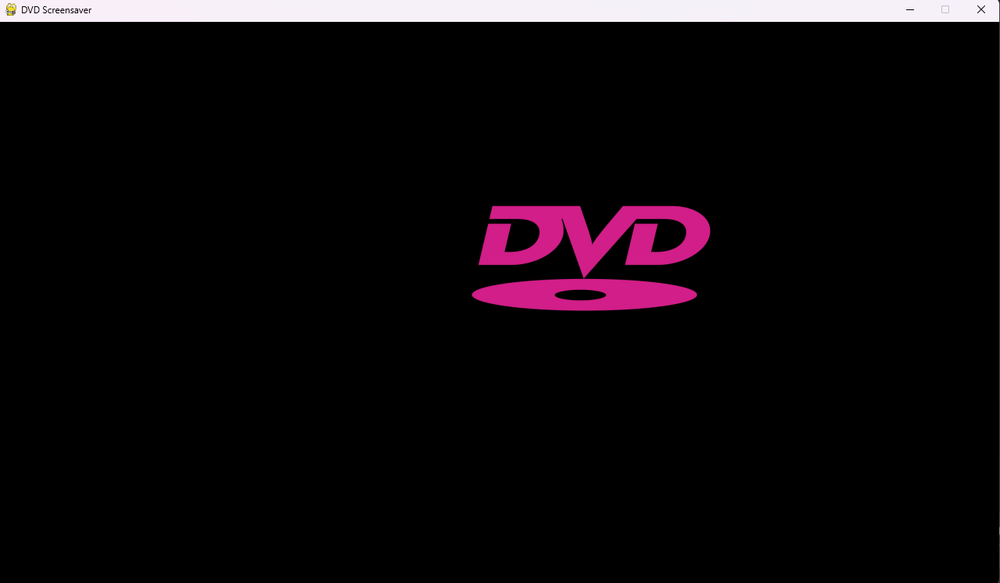

# About

Simple DVD screensaver recreation in Pygame.



## Features
- DVD screensaver object changes color when it hits any edge of the window
- A sound effect plays in the rare event the object hits a corner!

# Installation
**Note: Use with Python 3.13**

1. Clone repository
```bash
git clone https://github.com/somebodythirtythree/pygame-dvd-screensaver-replica.git
```
2. Install pygame
```bash
pip install pygame
```
3. Run the Python file
```bash
python main.py
```
4. Enjoy the bouncing rectangle.

